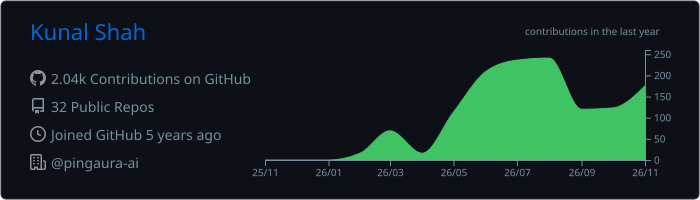
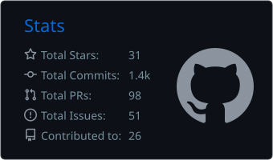
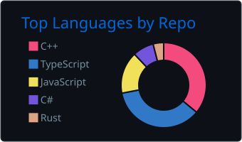
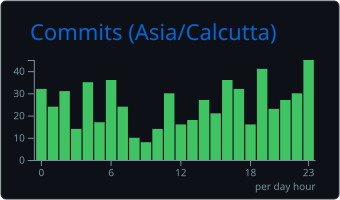
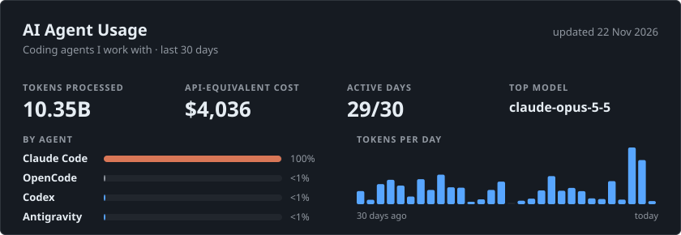

# Kunal Shah

Applied AI Engineer at [PingAura AI](https://pingaura.ai), building AI agents, Web3 apps and mobile products. 6x hackathon winner.

[LinkedIn](https://linkedin.com/in/kunalshah017) · [X](https://x.com/kunalshah017_v2) · [Website](https://kunalshah017.is-a.dev)

## Hackathon Wins & Projects

| Project | What it does | Recognition |
| :-- | :-- | :-- |
| [**Invocta**](https://github.com/Invocta/Android-App) | Android AI agent that drives your phone through accessibility + vision | 🥇 Best Use of Gemma 4 & Best Open-Source AI Project · Hacktoberfest Hack Day Mumbai x FAIR |
| [**Myference**](https://github.com/kunalshah017/myference) | Monad-native marketplace that turns idle computers into paid AI inference providers | 🥇 Winner · Monad Blitz Online 2026 |
| [**fheENV**](https://fheenv.vercel.app) | Zero-trust `.env` secrets manager powered by Fully Homomorphic Encryption | 🥇 Winner · Fhenix Buildathon |
| [**Web3Ads**](https://github.com/kunalshah017/web3ads) | Privacy-preserving ad platform on Base with zkProofs | 🥈 1st Runner-up · HeyElsa AI track, ETH Mumbai 2026 |
| [**MelodyPay**](https://melodypay.vercel.app) | Air-gapped crypto payments over sound, with AI agent-to-agent mode | 🎖️ Consolation Prize · Monad Blitz Mumbai V3 |
| [**Choices**](https://github.com/kunalshah017/choices-an-anti-drug-adventure) | Choice-based storytelling game for anti-drug awareness | 🥈 1st Runner-up · National Haryana Police Hackathon |

## Tech Stack

<b>AI Coding Agents</b> 
<a href="https://claude.com/product/claude-code" title="Claude Code"><picture><source media="(prefers-color-scheme: light)" srcset="https://raw.githubusercontent.com/kunalshah017/kunalshah017/main/src/images/icons/claude-code-light.svg"></picture></a>&nbsp;
<a href="https://openai.com/codex" title="Codex"><picture><source media="(prefers-color-scheme: light)" srcset="https://raw.githubusercontent.com/kunalshah017/kunalshah017/main/src/images/icons/codex-light.svg"></picture></a>&nbsp;
<a href="https://opencode.ai" title="OpenCode"><picture><source media="(prefers-color-scheme: light)" srcset="https://raw.githubusercontent.com/kunalshah017/kunalshah017/main/src/images/icons/opencode-light.svg"></picture></a>&nbsp;
<a href="https://herdr.dev" title="Herdr"><picture><source media="(prefers-color-scheme: light)" srcset="https://raw.githubusercontent.com/kunalshah017/kunalshah017/main/src/images/icons/herdr-light.svg"></picture></a>

<b>Languages</b> 
<a href="https://www.typescriptlang.org" title="TypeScript"><picture><source media="(prefers-color-scheme: light)" srcset="https://skillicons.dev/icons?i=ts&theme=light"></picture></a>&nbsp;
<a href="https://developer.mozilla.org/en-US/docs/Web/JavaScript" title="JavaScript"><picture><source media="(prefers-color-scheme: light)" srcset="https://skillicons.dev/icons?i=js&theme=light"></picture></a>&nbsp;
<a href="https://www.python.org" title="Python"><picture><source media="(prefers-color-scheme: light)" srcset="https://skillicons.dev/icons?i=py&theme=light"></picture></a>&nbsp;
<a href="https://soliditylang.org" title="Solidity"><picture><source media="(prefers-color-scheme: light)" srcset="https://skillicons.dev/icons?i=solidity&theme=light"></picture></a>&nbsp;
<a href="https://isocpp.org" title="C++"><picture><source media="(prefers-color-scheme: light)" srcset="https://skillicons.dev/icons?i=cpp&theme=light"></picture></a>

<b>Languages (AI-assisted)</b> 
<a href="https://www.rust-lang.org" title="Rust"><picture><source media="(prefers-color-scheme: light)" srcset="https://skillicons.dev/icons?i=rust&theme=light"></picture></a>&nbsp;
<a href="https://kotlinlang.org" title="Kotlin"><picture><source media="(prefers-color-scheme: light)" srcset="https://skillicons.dev/icons?i=kotlin&theme=light"></picture></a>&nbsp;
<a href="https://learn.microsoft.com/en-us/dotnet/csharp/" title="C#"><picture><source media="(prefers-color-scheme: light)" srcset="https://skillicons.dev/icons?i=cs&theme=light"></picture></a>&nbsp;
<a href="https://go.dev" title="Go"><picture><source media="(prefers-color-scheme: light)" srcset="https://skillicons.dev/icons?i=go&theme=light"></picture></a>

<b>Frontend & Mobile</b> 
<a href="https://react.dev" title="React & React Native"><picture><source media="(prefers-color-scheme: light)" srcset="https://skillicons.dev/icons?i=react&theme=light"></picture></a>&nbsp;
<a href="https://nextjs.org" title="Next.js"><picture><source media="(prefers-color-scheme: light)" srcset="https://skillicons.dev/icons?i=nextjs&theme=light"></picture></a>&nbsp;
<a href="https://tailwindcss.com" title="Tailwind CSS"><picture><source media="(prefers-color-scheme: light)" srcset="https://skillicons.dev/icons?i=tailwind&theme=light"></picture></a>&nbsp;
<a href="https://vite.dev" title="Vite"><picture><source media="(prefers-color-scheme: light)" srcset="https://skillicons.dev/icons?i=vite&theme=light"></picture></a>&nbsp;
<a href="https://flutter.dev" title="Flutter"><picture><source media="(prefers-color-scheme: light)" srcset="https://skillicons.dev/icons?i=flutter&theme=light"></picture></a>&nbsp;
<a href="https://developer.android.com/studio" title="Android"><picture><source media="(prefers-color-scheme: light)" srcset="https://skillicons.dev/icons?i=androidstudio&theme=light"></picture></a>&nbsp;
<a href="https://developer.mozilla.org/en-US/docs/Web/HTML" title="HTML"><picture><source media="(prefers-color-scheme: light)" srcset="https://skillicons.dev/icons?i=html&theme=light"></picture></a>&nbsp;
<a href="https://developer.mozilla.org/en-US/docs/Web/CSS" title="CSS"><picture><source media="(prefers-color-scheme: light)" srcset="https://skillicons.dev/icons?i=css&theme=light"></picture></a>

<b>Backend & Data</b> 
<a href="https://nodejs.org" title="Node.js"><picture><source media="(prefers-color-scheme: light)" srcset="https://skillicons.dev/icons?i=nodejs&theme=light"></picture></a>&nbsp;
<a href="https://expressjs.com" title="Express"><picture><source media="(prefers-color-scheme: light)" srcset="https://skillicons.dev/icons?i=express&theme=light"></picture></a>&nbsp;
<a href="https://fastapi.tiangolo.com" title="FastAPI"><picture><source media="(prefers-color-scheme: light)" srcset="https://skillicons.dev/icons?i=fastapi&theme=light"></picture></a>&nbsp;
<a href="https://supabase.com" title="Supabase"><picture><source media="(prefers-color-scheme: light)" srcset="https://skillicons.dev/icons?i=supabase&theme=light"></picture></a>&nbsp;
<a href="https://www.postgresql.org" title="PostgreSQL"><picture><source media="(prefers-color-scheme: light)" srcset="https://skillicons.dev/icons?i=postgres&theme=light"></picture></a>&nbsp;
<a href="https://www.mongodb.com" title="MongoDB"><picture><source media="(prefers-color-scheme: light)" srcset="https://skillicons.dev/icons?i=mongodb&theme=light"></picture></a>&nbsp;
<a href="https://redis.io" title="Redis"><picture><source media="(prefers-color-scheme: light)" srcset="https://skillicons.dev/icons?i=redis&theme=light"></picture></a>&nbsp;
<a href="https://dotnet.microsoft.com" title=".NET"><picture><source media="(prefers-color-scheme: light)" srcset="https://skillicons.dev/icons?i=dotnet&theme=light"></picture></a>

<b>Cloud & DevOps</b> 
<a href="https://www.docker.com" title="Docker"><picture><source media="(prefers-color-scheme: light)" srcset="https://skillicons.dev/icons?i=docker&theme=light"></picture></a>&nbsp;
<a href="https://kubernetes.io" title="Kubernetes"><picture><source media="(prefers-color-scheme: light)" srcset="https://skillicons.dev/icons?i=kubernetes&theme=light"></picture></a>&nbsp;
<a href="https://cloud.google.com" title="Google Cloud"><picture><source media="(prefers-color-scheme: light)" srcset="https://skillicons.dev/icons?i=gcp&theme=light"></picture></a>&nbsp;
<a href="https://azure.microsoft.com" title="Azure"><picture><source media="(prefers-color-scheme: light)" srcset="https://skillicons.dev/icons?i=azure&theme=light"></picture></a>&nbsp;
<a href="https://developer.hashicorp.com/terraform" title="Terraform"><picture><source media="(prefers-color-scheme: light)" srcset="https://skillicons.dev/icons?i=terraform&theme=light"></picture></a>&nbsp;
<a href="https://vercel.com" title="Vercel"><picture><source media="(prefers-color-scheme: light)" srcset="https://skillicons.dev/icons?i=vercel&theme=light"></picture></a>&nbsp;
<a href="https://www.cloudflare.com" title="Cloudflare"><picture><source media="(prefers-color-scheme: light)" srcset="https://skillicons.dev/icons?i=cloudflare&theme=light"></picture></a>&nbsp;
<a href="https://www.kernel.org" title="Linux"><picture><source media="(prefers-color-scheme: light)" srcset="https://skillicons.dev/icons?i=linux&theme=light"></picture></a>&nbsp;
<a href="https://git-scm.com" title="Git"><picture><source media="(prefers-color-scheme: light)" srcset="https://skillicons.dev/icons?i=git&theme=light"></picture></a>

<b>Design & Video</b> 
<a href="https://www.figma.com" title="Figma"><picture><source media="(prefers-color-scheme: light)" srcset="https://skillicons.dev/icons?i=figma&theme=light"></picture></a>&nbsp;
<a href="https://www.adobe.com/products/illustrator.html" title="Adobe Illustrator"><picture><source media="(prefers-color-scheme: light)" srcset="https://skillicons.dev/icons?i=ai&theme=light"></picture></a>&nbsp;
<a href="https://www.adobe.com/products/photoshop.html" title="Adobe Photoshop"><picture><source media="(prefers-color-scheme: light)" srcset="https://skillicons.dev/icons?i=ps&theme=light"></picture></a>&nbsp;
<a href="https://www.blackmagicdesign.com/products/davinciresolve" title="DaVinci Resolve"><picture><source media="(prefers-color-scheme: light)" srcset="https://raw.githubusercontent.com/kunalshah017/kunalshah017/main/src/images/icons/davinci-resolve-light.svg"></picture></a>&nbsp;
<a href="https://www.blender.org" title="Blender"><picture><source media="(prefers-color-scheme: light)" srcset="https://skillicons.dev/icons?i=blender&theme=light"></picture></a>

## GitHub Stats

<picture><source media="(prefers-color-scheme: light)" srcset="https://raw.githubusercontent.com/kunalshah017/kunalshah017/output/light/0-profile-details.svg"></picture>

<picture><source media="(prefers-color-scheme: light)" srcset="https://raw.githubusercontent.com/kunalshah017/kunalshah017/output/light/3-stats.svg"></picture>
<picture><source media="(prefers-color-scheme: light)" srcset="https://raw.githubusercontent.com/kunalshah017/kunalshah017/output/light/2-most-commit-language.svg"></picture>
<picture><source media="(prefers-color-scheme: light)" srcset="https://raw.githubusercontent.com/kunalshah017/kunalshah017/output/light/1-repos-per-language.svg"></picture>
<picture><source media="(prefers-color-scheme: light)" srcset="https://raw.githubusercontent.com/kunalshah017/kunalshah017/output/light/4-productive-time.svg"></picture>

## AI Agent Usage

<picture><source media="(prefers-color-scheme: light)" srcset="https://raw.githubusercontent.com/kunalshah017/kunalshah017/main/src/images/ai-usage-light.svg"></picture>
