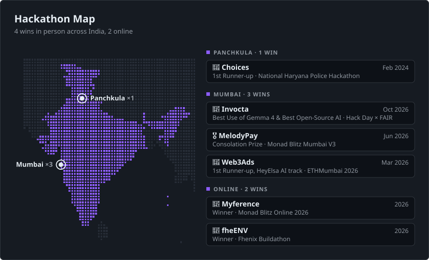
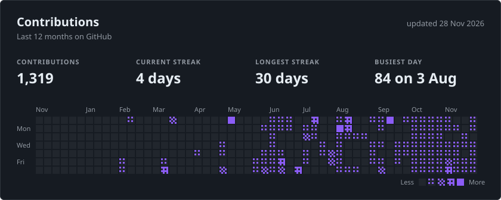
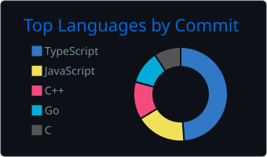

<picture><source media="(prefers-color-scheme: light)" srcset="https://raw.githubusercontent.com/kunalshah017/kunalshah017/main/src/images/banner-light.png"></picture>

# Hi! I'm Kunal!

Applied AI Engineer at [PingAura AI](https://pingaura.ai), building AI agents, Web3 apps and mobile products. 6x hackathon winner.

[LinkedIn](https://linkedin.com/in/kunalshah017) · [X](https://x.com/kunalshah017_v2) · [Website](https://kunalshah017.is-a.dev)

## My Top Projects

| Project | What it does | Recognition |
| :-- | :-- | :-- |
| [**Invocta**](https://github.com/Invocta/Android-App) | Android AI agent that drives your phone through accessibility + vision | 🥇 Best Use of Gemma 4 & Best Open-Source AI Project · Hacktoberfest Hack Day Mumbai x FAIR |
| [**Myference**](https://github.com/kunalshah017/myference) | Monad-native marketplace that turns idle computers into paid AI inference providers | 🥇 Winner · Monad Blitz Online 2026 |
| [**fheENV**](https://fheenv.vercel.app) | Zero-trust `.env` secrets manager powered by Fully Homomorphic Encryption | 🥇 Winner · Fhenix Buildathon |
| [**Web3Ads**](https://github.com/kunalshah017/web3ads) | Privacy-preserving ad platform on Base with zkProofs | 🥈 1st Runner-up · HeyElsa AI track, ETH Mumbai 2026 |
| [**MelodyPay**](https://melodypay.vercel.app) | Air-gapped crypto payments over sound, with AI agent-to-agent mode | 🎖️ Consolation Prize · Monad Blitz Mumbai V3 |
| [**Choices**](https://github.com/kunalshah017/choices-an-anti-drug-adventure) | Choice-based storytelling game for anti-drug awareness | 🥈 1st Runner-up · National Haryana Police Hackathon |

<picture><source media="(prefers-color-scheme: light)" srcset="https://raw.githubusercontent.com/kunalshah017/kunalshah017/main/src/images/hackathons-light.svg"></picture>

## Recently Merged

<!-- recent-prs:start -->
- **[fheENV](https://github.com/Team-Managed/fheENV)** · [feat(frontend): robots.txt, llms.txt and the fheENV favicon](https://github.com/Team-Managed/fheENV/pull/49) · 20 Nov 2026
- **[EVM-Web3MCP](https://github.com/Team-Managed/EVM-Web3MCP)** · [SDK 0.0.2: accept the manifest fields search added](https://github.com/Team-Managed/EVM-Web3MCP/pull/11) · 7 Nov 2026
- **[EVM-Web3MCP](https://github.com/Team-Managed/EVM-Web3MCP)** · [Docs: an onchain web for AI agents](https://github.com/Team-Managed/EVM-Web3MCP/pull/10) · 6 Nov 2026
- **[Solana-Web3MCP](https://github.com/Team-Managed/Solana-Web3MCP)** · [Use web3mcp.org across the website and project](https://github.com/Team-Managed/Solana-Web3MCP/pull/5) · 19 Oct 2026
- **[Solana-Web3MCP](https://github.com/Team-Managed/Solana-Web3MCP)** · [Document Web3MCP project and remove local design config](https://github.com/Team-Managed/Solana-Web3MCP/pull/4) · 18 Oct 2026
- **[fheENV](https://github.com/Team-Managed/fheENV)** · [feat(cli): add production-grade cross-platform signer custody](https://github.com/Team-Managed/fheENV/pull/42) · 31 Jul 2026
<!-- recent-prs:end -->

## Tech Stack

```mermaid
---
config:
  layout: dagre
  flowchart:
    nodeSpacing: 6
    rankSpacing: 22
    padding: 6
---
flowchart TB
  subgraph agents["Me ⇄ AI Coding Agents"]
    direction TB
    me@{ img: "https://raw.githubusercontent.com/kunalshah017/kunalshah017/main/src/images/stack/me.png", label: "", w: 80, h: 80, constraint: "on" }
    bridge@{ img: "https://raw.githubusercontent.com/kunalshah017/kunalshah017/main/src/images/stack/bridge.svg", label: "", w: 176, h: 64, constraint: "on" }
    claudecode@{ img: "https://raw.githubusercontent.com/kunalshah017/kunalshah017/main/src/images/stack/claude-code.svg", label: "", w: 40, h: 40, constraint: "on" }
    codex@{ img: "https://raw.githubusercontent.com/kunalshah017/kunalshah017/main/src/images/stack/codex.svg", label: "", w: 40, h: 40, constraint: "on" }
    opencode@{ img: "https://raw.githubusercontent.com/kunalshah017/kunalshah017/main/src/images/stack/opencode.svg", label: "", w: 40, h: 40, constraint: "on" }
    herdr@{ img: "https://raw.githubusercontent.com/kunalshah017/kunalshah017/main/src/images/stack/herdr.svg", label: "", w: 40, h: 40, constraint: "on" }
  end
  subgraph langs["Languages"]
    direction TB
    ts@{ img: "https://raw.githubusercontent.com/kunalshah017/kunalshah017/main/src/images/stack/ts.svg", label: "", w: 40, h: 40, constraint: "on" }
    js@{ img: "https://raw.githubusercontent.com/kunalshah017/kunalshah017/main/src/images/stack/js.svg", label: "", w: 40, h: 40, constraint: "on" }
    py@{ img: "https://raw.githubusercontent.com/kunalshah017/kunalshah017/main/src/images/stack/py.svg", label: "", w: 40, h: 40, constraint: "on" }
    solidity@{ img: "https://raw.githubusercontent.com/kunalshah017/kunalshah017/main/src/images/stack/solidity.svg", label: "", w: 40, h: 40, constraint: "on" }
    cpp@{ img: "https://raw.githubusercontent.com/kunalshah017/kunalshah017/main/src/images/stack/cpp.svg", label: "", w: 40, h: 40, constraint: "on" }
    cs@{ img: "https://raw.githubusercontent.com/kunalshah017/kunalshah017/main/src/images/stack/cs.svg", label: "", w: 40, h: 40, constraint: "on" }
  end
  subgraph assisted["Languages (AI-assisted)"]
    direction TB
    rust@{ img: "https://raw.githubusercontent.com/kunalshah017/kunalshah017/main/src/images/stack/rust.svg", label: "", w: 40, h: 40, constraint: "on" }
    kotlin@{ img: "https://raw.githubusercontent.com/kunalshah017/kunalshah017/main/src/images/stack/kotlin.svg", label: "", w: 40, h: 40, constraint: "on" }
    go@{ img: "https://raw.githubusercontent.com/kunalshah017/kunalshah017/main/src/images/stack/go.svg", label: "", w: 40, h: 40, constraint: "on" }
  end
  subgraph design["Design & Video"]
    direction TB
    figma@{ img: "https://raw.githubusercontent.com/kunalshah017/kunalshah017/main/src/images/stack/figma.svg", label: "", w: 40, h: 40, constraint: "on" }
    ai@{ img: "https://raw.githubusercontent.com/kunalshah017/kunalshah017/main/src/images/stack/ai.svg", label: "", w: 40, h: 40, constraint: "on" }
    ps@{ img: "https://raw.githubusercontent.com/kunalshah017/kunalshah017/main/src/images/stack/ps.svg", label: "", w: 40, h: 40, constraint: "on" }
    davinciresolve@{ img: "https://raw.githubusercontent.com/kunalshah017/kunalshah017/main/src/images/stack/davinci-resolve.svg", label: "", w: 40, h: 40, constraint: "on" }
    blender@{ img: "https://raw.githubusercontent.com/kunalshah017/kunalshah017/main/src/images/stack/blender.svg", label: "", w: 40, h: 40, constraint: "on" }
  end
  subgraph frontend["Frontend & Mobile"]
    direction TB
    react@{ img: "https://raw.githubusercontent.com/kunalshah017/kunalshah017/main/src/images/stack/react.svg", label: "", w: 40, h: 40, constraint: "on" }
    nextjs@{ img: "https://raw.githubusercontent.com/kunalshah017/kunalshah017/main/src/images/stack/nextjs.svg", label: "", w: 40, h: 40, constraint: "on" }
    flutter@{ img: "https://raw.githubusercontent.com/kunalshah017/kunalshah017/main/src/images/stack/flutter.svg", label: "", w: 40, h: 40, constraint: "on" }
    androidstudio@{ img: "https://raw.githubusercontent.com/kunalshah017/kunalshah017/main/src/images/stack/androidstudio.svg", label: "", w: 40, h: 40, constraint: "on" }
    expo@{ img: "https://raw.githubusercontent.com/kunalshah017/kunalshah017/main/src/images/stack/expo.svg", label: "", w: 40, h: 40, constraint: "on" }
    electron@{ img: "https://raw.githubusercontent.com/kunalshah017/kunalshah017/main/src/images/stack/electron.svg", label: "", w: 40, h: 40, constraint: "on" }
  end
  subgraph harness["Harness Engineering"]
    direction TB
    langchain@{ img: "https://raw.githubusercontent.com/kunalshah017/kunalshah017/main/src/images/stack/langchain.svg", label: "", w: 80, h: 40, constraint: "on" }
    langgraph@{ img: "https://raw.githubusercontent.com/kunalshah017/kunalshah017/main/src/images/stack/langgraph.svg", label: "", w: 80, h: 40, constraint: "on" }
    mem0@{ img: "https://raw.githubusercontent.com/kunalshah017/kunalshah017/main/src/images/stack/mem0.png", label: "", w: 40, h: 40, constraint: "on" }
    supermemory@{ img: "https://raw.githubusercontent.com/kunalshah017/kunalshah017/main/src/images/stack/supermemory.png", label: "", w: 40, h: 40, constraint: "on" }
  end
  subgraph backend["Backend & Data"]
    direction TB
    bun@{ img: "https://raw.githubusercontent.com/kunalshah017/kunalshah017/main/src/images/stack/bun.svg", label: "", w: 40, h: 40, constraint: "on" }
    express@{ img: "https://raw.githubusercontent.com/kunalshah017/kunalshah017/main/src/images/stack/express.svg", label: "", w: 40, h: 40, constraint: "on" }
    fastapi@{ img: "https://raw.githubusercontent.com/kunalshah017/kunalshah017/main/src/images/stack/fastapi.svg", label: "", w: 40, h: 40, constraint: "on" }
    axum@{ img: "https://raw.githubusercontent.com/kunalshah017/kunalshah017/main/src/images/stack/axum.svg", label: "", w: 40, h: 40, constraint: "on" }
    supabase@{ img: "https://raw.githubusercontent.com/kunalshah017/kunalshah017/main/src/images/stack/supabase.svg", label: "", w: 40, h: 40, constraint: "on" }
    postgres@{ img: "https://raw.githubusercontent.com/kunalshah017/kunalshah017/main/src/images/stack/postgres.svg", label: "", w: 40, h: 40, constraint: "on" }
    mongodb@{ img: "https://raw.githubusercontent.com/kunalshah017/kunalshah017/main/src/images/stack/mongodb.svg", label: "", w: 40, h: 40, constraint: "on" }
    dotnet@{ img: "https://raw.githubusercontent.com/kunalshah017/kunalshah017/main/src/images/stack/dotnet.svg", label: "", w: 40, h: 40, constraint: "on" }
  end
  subgraph cloud["Cloud & DevOps"]
    direction TB
    docker@{ img: "https://raw.githubusercontent.com/kunalshah017/kunalshah017/main/src/images/stack/docker.svg", label: "", w: 40, h: 40, constraint: "on" }
    kubernetes@{ img: "https://raw.githubusercontent.com/kunalshah017/kunalshah017/main/src/images/stack/kubernetes.svg", label: "", w: 40, h: 40, constraint: "on" }
    gcp@{ img: "https://raw.githubusercontent.com/kunalshah017/kunalshah017/main/src/images/stack/gcp.svg", label: "", w: 40, h: 40, constraint: "on" }
    azure@{ img: "https://raw.githubusercontent.com/kunalshah017/kunalshah017/main/src/images/stack/azure.svg", label: "", w: 40, h: 40, constraint: "on" }
    terraform@{ img: "https://raw.githubusercontent.com/kunalshah017/kunalshah017/main/src/images/stack/terraform.svg", label: "", w: 40, h: 40, constraint: "on" }
    cloudflare@{ img: "https://raw.githubusercontent.com/kunalshah017/kunalshah017/main/src/images/stack/cloudflare.svg", label: "", w: 40, h: 40, constraint: "on" }
    linux@{ img: "https://raw.githubusercontent.com/kunalshah017/kunalshah017/main/src/images/stack/linux.svg", label: "", w: 40, h: 40, constraint: "on" }
    git@{ img: "https://raw.githubusercontent.com/kunalshah017/kunalshah017/main/src/images/stack/git.svg", label: "", w: 40, h: 40, constraint: "on" }
  end
  subgraph obsai["AI Observability"]
    direction TB
    langsmith@{ img: "https://raw.githubusercontent.com/kunalshah017/kunalshah017/main/src/images/stack/langsmith.svg", label: "", w: 80, h: 40, constraint: "on" }
    langfuse@{ img: "https://raw.githubusercontent.com/kunalshah017/kunalshah017/main/src/images/stack/langfuse.png", label: "", w: 40, h: 40, constraint: "on" }
  end
  subgraph obsapps["App Observability"]
    direction TB
    posthog@{ img: "https://raw.githubusercontent.com/kunalshah017/kunalshah017/main/src/images/stack/posthog.svg", label: "", w: 40, h: 40, constraint: "on" }
    grafana@{ img: "https://raw.githubusercontent.com/kunalshah017/kunalshah017/main/src/images/stack/grafana.svg", label: "", w: 40, h: 40, constraint: "on" }
  end
  agents e0@---> design
  agents e1@---> langs
  agents e2@---> assisted
  design e3@---> frontend
  langs e4@---> frontend
  langs e5@---> harness
  langs e6@---> backend
  assisted e7@---> backend
  frontend e8@---> cloud
  harness e9@---> cloud
  backend e10@---> cloud
  cloud e11@---> obsapps
  cloud e12@---> obsai
  e0@{ animate: true }
  e1@{ animate: true }
  e2@{ animate: true }
  e3@{ animate: true }
  e4@{ animate: true }
  e5@{ animate: true }
  e6@{ animate: true }
  e7@{ animate: true }
  e8@{ animate: true }
  e9@{ animate: true }
  e10@{ animate: true }
  e11@{ animate: true }
  e12@{ animate: true }
  classDef icon fill:none,stroke:none,font-size:0px
  classDef group fill:none,stroke:#8B5CF6,stroke-width:1px
  classDef focus fill:#8B5CF61F,stroke:#8B5CF6,stroke-width:2.5px
  class me,bridge,claudecode,codex,opencode,herdr,ts,js,py,solidity,cpp,cs,rust,kotlin,go,figma,ai,ps,davinciresolve,blender,react,nextjs,flutter,androidstudio,expo,electron,langchain,langgraph,mem0,supermemory,bun,express,fastapi,axum,supabase,postgres,mongodb,dotnet,docker,kubernetes,gcp,azure,terraform,cloudflare,linux,git,langsmith,langfuse,posthog,grafana icon
  class agents,langs,assisted,design,frontend,backend,cloud,obsai,obsapps group
  class harness focus
  linkStyle default stroke:#8B5CF6,stroke-width:1.5px
  click claudecode href "https://claude.com/product/claude-code" "Claude Code" _blank
  click codex href "https://openai.com/codex" "Codex" _blank
  click opencode href "https://opencode.ai" "OpenCode" _blank
  click herdr href "https://herdr.dev" "Herdr" _blank
  click ts href "https://www.typescriptlang.org" "TypeScript" _blank
  click js href "https://developer.mozilla.org/en-US/docs/Web/JavaScript" "JavaScript" _blank
  click py href "https://www.python.org" "Python" _blank
  click solidity href "https://soliditylang.org" "Solidity" _blank
  click cpp href "https://isocpp.org" "C++" _blank
  click cs href "https://learn.microsoft.com/en-us/dotnet/csharp/" "C#" _blank
  click rust href "https://www.rust-lang.org" "Rust" _blank
  click kotlin href "https://kotlinlang.org" "Kotlin" _blank
  click go href "https://go.dev" "Go" _blank
  click figma href "https://www.figma.com" "Figma" _blank
  click ai href "https://www.adobe.com/products/illustrator.html" "Adobe Illustrator" _blank
  click ps href "https://www.adobe.com/products/photoshop.html" "Adobe Photoshop" _blank
  click davinciresolve href "https://www.blackmagicdesign.com/products/davinciresolve" "DaVinci Resolve" _blank
  click blender href "https://www.blender.org" "Blender" _blank
  click react href "https://react.dev" "React & React Native" _blank
  click nextjs href "https://nextjs.org" "Next.js" _blank
  click flutter href "https://flutter.dev" "Flutter" _blank
  click androidstudio href "https://developer.android.com/studio" "Android" _blank
  click expo href "https://expo.dev" "Expo" _blank
  click electron href "https://www.electronjs.org" "Electron" _blank
  click langchain href "https://www.langchain.com" "LangChain" _blank
  click langgraph href "https://www.langchain.com/langgraph" "LangGraph" _blank
  click mem0 href "https://mem0.ai" "Mem0" _blank
  click supermemory href "https://supermemory.ai" "Supermemory" _blank
  click bun href "https://bun.sh" "Bun" _blank
  click express href "https://expressjs.com" "Express" _blank
  click fastapi href "https://fastapi.tiangolo.com" "FastAPI" _blank
  click axum href "https://github.com/tokio-rs/axum" "Axum" _blank
  click supabase href "https://supabase.com" "Supabase" _blank
  click postgres href "https://www.postgresql.org" "PostgreSQL" _blank
  click mongodb href "https://www.mongodb.com" "MongoDB" _blank
  click dotnet href "https://dotnet.microsoft.com" ".NET" _blank
  click docker href "https://www.docker.com" "Docker" _blank
  click kubernetes href "https://kubernetes.io" "Kubernetes" _blank
  click gcp href "https://cloud.google.com" "Google Cloud" _blank
  click azure href "https://azure.microsoft.com" "Azure" _blank
  click terraform href "https://developer.hashicorp.com/terraform" "Terraform" _blank
  click cloudflare href "https://www.cloudflare.com" "Cloudflare" _blank
  click linux href "https://www.kernel.org" "Linux" _blank
  click git href "https://git-scm.com" "Git" _blank
  click langsmith href "https://www.langchain.com/langsmith" "LangSmith" _blank
  click langfuse href "https://langfuse.com" "Langfuse" _blank
  click posthog href "https://posthog.com" "PostHog" _blank
  click grafana href "https://grafana.com" "Grafana" _blank
```

## GitHub Stats

<picture><source media="(prefers-color-scheme: light)" srcset="https://raw.githubusercontent.com/kunalshah017/kunalshah017/output/light/contributions.svg"></picture>
<p>
<picture><source media="(prefers-color-scheme: light)" srcset="https://raw.githubusercontent.com/kunalshah017/kunalshah017/output/light/3-stats.svg"></picture>
<picture><source media="(prefers-color-scheme: light)" srcset="https://raw.githubusercontent.com/kunalshah017/kunalshah017/output/light/2-most-commit-language.svg"></picture>
</p>

## AI Agent Usage

<picture><source media="(prefers-color-scheme: light)" srcset="https://raw.githubusercontent.com/kunalshah017/kunalshah017/main/src/images/ai-usage-light.svg"></picture>
