<h1 align="center">Hi 👋, I'm Kunal Shah</h1>

<h3 align="center">Welcome to my Coding World</h3>

<a href="https://kunalshah017.is-a.dev"><picture><source media="(prefers-color-scheme: light)" srcset="https://readme-typing-svg.demolab.com?font=Fira+Code&weight=600&size=20&pause=1200&color=B620C9&center=true&vCenter=true&width=640&lines=Applied+AI+Engineer+%40+PingAura+AI;AI-Agent-First+Developer+%F0%9F%A4%96;6x+Hackathon+Winner+%F0%9F%8F%86;Building+AI+Agents%2C+Web3+%26+Mobile+Apps;From+Scratch+cats+to+shipping+to+prod+%F0%9F%9A%80"></picture></a>

<picture><source media="(prefers-color-scheme: light)" srcset="https://raw.githubusercontent.com/kunalshah017/kunalshah017/main/src/images/galaxy-light.svg"></picture>

 

 

	

&nbsp Join the Vibe 🎶
  

- 💼 Applied AI Engineer at [**PingAura AI**](https://pingaura.ai), building Answer Engine Optimization (AEO) tools for enterprise clients

- 🤖 **AI-agent-first developer**: Claude Code, Codex & OpenCode are my full-time interns, I'm the tech lead who reviews every PR

- 🌱 I’m currently building **AI Agents | MCP Servers | Web3 | Android AI Agents**

- 🏆 **6x hackathon winner**: ETH Mumbai 2026, Monad Blitz (x2), Fhenix Buildathon, Hacktoberfest Hack Day Mumbai x FAIR, Haryana Police Hackathon

- 👨‍💻 All of my projects are available at my [Personal Website](https://kunalshah017.is-a.dev)

- 💬 Ask me about **AI Agents, Web3, React Native, Full-Stack**

- 📫 How to reach me - [LinkedIn](https://linkedin.com/in/kunalshah017) | [X](https://x.com/kunalshah017_v2) | [Telegram](https://t.me/kunalshah017)

 
<h3>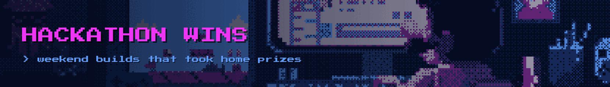</h3>

| Project | What it does | Recognition |
| :-- | :-- | :-- |
| [**Invocta**](https://github.com/Invocta/Android-App) | Android AI agent that drives your phone through accessibility + vision | 🥇 Best Use of Gemma 4 & Best Open-Source AI Project · Hacktoberfest Hack Day Mumbai x FAIR |
| [**Myference**](https://github.com/kunalshah017/myference) | Monad-native marketplace that turns idle computers into paid AI inference providers | 🥇 Winner · Monad Blitz Online 2026 |
| [**fheENV**](https://fheenv.vercel.app) | Zero-trust `.env` secrets manager powered by Fully Homomorphic Encryption | 🥇 Winner · Fhenix Buildathon |
| [**Web3Ads**](https://github.com/kunalshah017/web3ads) | Privacy-preserving ad platform on Base with zkProofs | 🥈 1st Runner-up · HeyElsa AI track, ETH Mumbai 2026 |
| [**MelodyPay**](https://melodypay.vercel.app) | Air-gapped crypto payments over sound, with AI agent-to-agent mode | 🎖️ Consolation Prize · Monad Blitz Mumbai V3 |
| [**Choices**](https://github.com/kunalshah017/choices-an-anti-drug-adventure) | Choice-based storytelling game for anti-drug awareness | 🥈 1st Runner-up · National Haryana Police Hackathon |

<table>
<tr>
<td width="110"><a href="https://kunalshah017.gumroad.com/l/dsa-made-easy">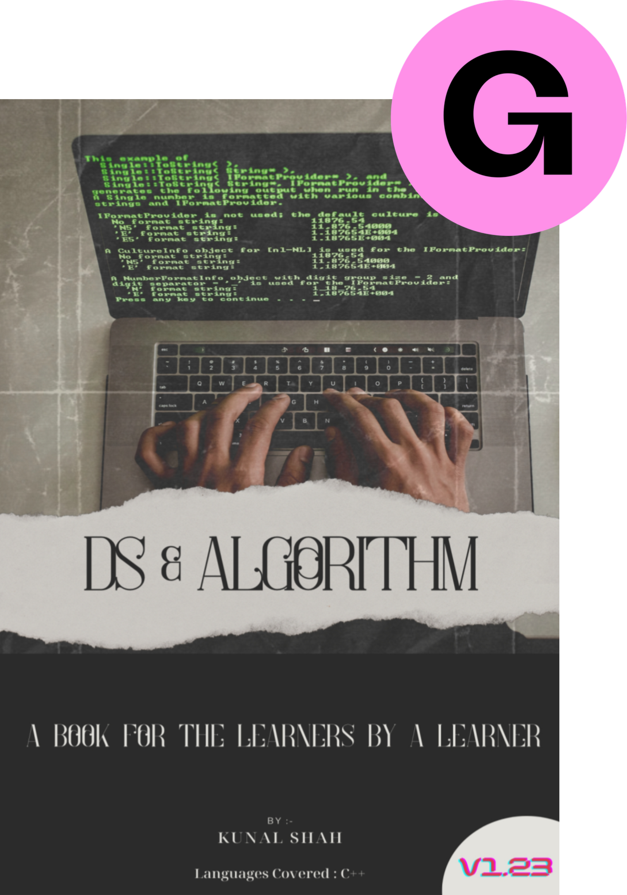</a></td>
<td>📚 <b>Where it started:</b> back in high school I wrote <a href="https://kunalshah017.gumroad.com/l/dsa-made-easy">DSA Made Easy</a>, a beginner-friendly ebook on data structures & algorithms in C++, written as I learned them. The source code lives in <a href="https://github.com/kunalshah017/Learning-CPP">Learning CPP</a>.</td>
</tr>
</table>

<h3>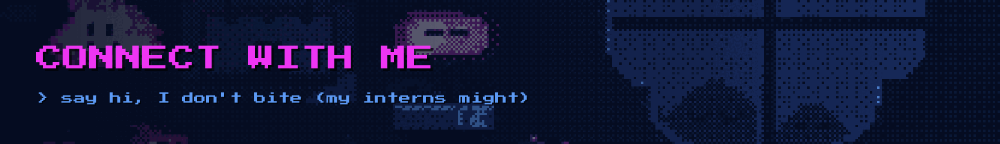</h3>

<a href="https://x.com/kunalshah017_v2" target="blank" title="X: @kunalshah017_v2"><picture><source media="(prefers-color-scheme: light)" srcset="https://raw.githubusercontent.com/kunalshah017/kunalshah017/main/src/images/icons/x-light.svg"></picture></a>

<a href="https://hashnode.com/@kunalshah017" target="blank">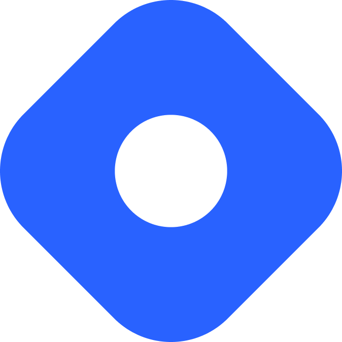</a>

<h3>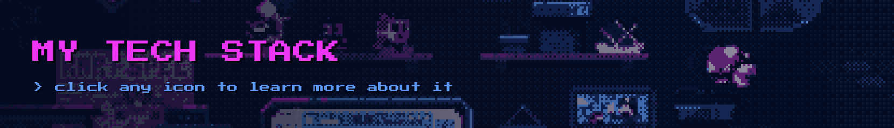</h3>

<b>My Full-time Interns 🤖</b> <i>they all share one office: Herdr</i>  
<a href="https://claude.com/product/claude-code" title="Claude Code"><picture><source media="(prefers-color-scheme: light)" srcset="https://raw.githubusercontent.com/kunalshah017/kunalshah017/main/src/images/icons/claude-code-light.svg"></picture></a>&nbsp;
<a href="https://openai.com/codex" title="Codex"><picture><source media="(prefers-color-scheme: light)" srcset="https://raw.githubusercontent.com/kunalshah017/kunalshah017/main/src/images/icons/codex-light.svg"></picture></a>&nbsp;
<a href="https://opencode.ai" title="OpenCode"><picture><source media="(prefers-color-scheme: light)" srcset="https://raw.githubusercontent.com/kunalshah017/kunalshah017/main/src/images/icons/opencode-light.svg"></picture></a>&nbsp;
<a href="https://herdr.dev" title="Herdr"><picture><source media="(prefers-color-scheme: light)" srcset="https://raw.githubusercontent.com/kunalshah017/kunalshah017/main/src/images/icons/herdr-light.svg"></picture></a>

<b>Languages</b> <i>I write these myself</i>  
<a href="https://www.typescriptlang.org" title="TypeScript"><picture><source media="(prefers-color-scheme: light)" srcset="https://skillicons.dev/icons?i=ts&theme=light"></picture></a>&nbsp;
<a href="https://developer.mozilla.org/en-US/docs/Web/JavaScript" title="JavaScript"><picture><source media="(prefers-color-scheme: light)" srcset="https://skillicons.dev/icons?i=js&theme=light"></picture></a>&nbsp;
<a href="https://www.python.org" title="Python"><picture><source media="(prefers-color-scheme: light)" srcset="https://skillicons.dev/icons?i=py&theme=light"></picture></a>&nbsp;
<a href="https://soliditylang.org" title="Solidity"><picture><source media="(prefers-color-scheme: light)" srcset="https://skillicons.dev/icons?i=solidity&theme=light"></picture></a>&nbsp;
<a href="https://isocpp.org" title="C++"><picture><source media="(prefers-color-scheme: light)" srcset="https://skillicons.dev/icons?i=cpp&theme=light"></picture></a>

<b>Languages</b> <i>my interns write, I review & ship</i>  
<a href="https://www.rust-lang.org" title="Rust"><picture><source media="(prefers-color-scheme: light)" srcset="https://skillicons.dev/icons?i=rust&theme=light"></picture></a>&nbsp;
<a href="https://kotlinlang.org" title="Kotlin"><picture><source media="(prefers-color-scheme: light)" srcset="https://skillicons.dev/icons?i=kotlin&theme=light"></picture></a>&nbsp;
<a href="https://learn.microsoft.com/en-us/dotnet/csharp/" title="C#"><picture><source media="(prefers-color-scheme: light)" srcset="https://skillicons.dev/icons?i=cs&theme=light"></picture></a>&nbsp;
<a href="https://go.dev" title="Go"><picture><source media="(prefers-color-scheme: light)" srcset="https://skillicons.dev/icons?i=go&theme=light"></picture></a>

<b>Frontend & Mobile</b>  
<a href="https://react.dev" title="React & React Native"><picture><source media="(prefers-color-scheme: light)" srcset="https://skillicons.dev/icons?i=react&theme=light"></picture></a>&nbsp;
<a href="https://nextjs.org" title="Next.js"><picture><source media="(prefers-color-scheme: light)" srcset="https://skillicons.dev/icons?i=nextjs&theme=light"></picture></a>&nbsp;
<a href="https://tailwindcss.com" title="Tailwind CSS"><picture><source media="(prefers-color-scheme: light)" srcset="https://skillicons.dev/icons?i=tailwind&theme=light"></picture></a>&nbsp;
<a href="https://vite.dev" title="Vite"><picture><source media="(prefers-color-scheme: light)" srcset="https://skillicons.dev/icons?i=vite&theme=light"></picture></a>&nbsp;
<a href="https://flutter.dev" title="Flutter"><picture><source media="(prefers-color-scheme: light)" srcset="https://skillicons.dev/icons?i=flutter&theme=light"></picture></a>&nbsp;
<a href="https://developer.android.com/studio" title="Android"><picture><source media="(prefers-color-scheme: light)" srcset="https://skillicons.dev/icons?i=androidstudio&theme=light"></picture></a>&nbsp;
<a href="https://developer.mozilla.org/en-US/docs/Web/HTML" title="HTML"><picture><source media="(prefers-color-scheme: light)" srcset="https://skillicons.dev/icons?i=html&theme=light"></picture></a>&nbsp;
<a href="https://developer.mozilla.org/en-US/docs/Web/CSS" title="CSS"><picture><source media="(prefers-color-scheme: light)" srcset="https://skillicons.dev/icons?i=css&theme=light"></picture></a>

<b>Backend, AI & Data</b>  
<a href="https://nodejs.org" title="Node.js"><picture><source media="(prefers-color-scheme: light)" srcset="https://skillicons.dev/icons?i=nodejs&theme=light"></picture></a>&nbsp;
<a href="https://expressjs.com" title="Express"><picture><source media="(prefers-color-scheme: light)" srcset="https://skillicons.dev/icons?i=express&theme=light"></picture></a>&nbsp;
<a href="https://fastapi.tiangolo.com" title="FastAPI"><picture><source media="(prefers-color-scheme: light)" srcset="https://skillicons.dev/icons?i=fastapi&theme=light"></picture></a>&nbsp;
<a href="https://supabase.com" title="Supabase"><picture><source media="(prefers-color-scheme: light)" srcset="https://skillicons.dev/icons?i=supabase&theme=light"></picture></a>&nbsp;
<a href="https://www.postgresql.org" title="PostgreSQL"><picture><source media="(prefers-color-scheme: light)" srcset="https://skillicons.dev/icons?i=postgres&theme=light"></picture></a>&nbsp;
<a href="https://www.mongodb.com" title="MongoDB"><picture><source media="(prefers-color-scheme: light)" srcset="https://skillicons.dev/icons?i=mongodb&theme=light"></picture></a>&nbsp;
<a href="https://redis.io" title="Redis"><picture><source media="(prefers-color-scheme: light)" srcset="https://skillicons.dev/icons?i=redis&theme=light"></picture></a>&nbsp;
<a href="https://dotnet.microsoft.com" title=".NET"><picture><source media="(prefers-color-scheme: light)" srcset="https://skillicons.dev/icons?i=dotnet&theme=light"></picture></a>

<b>Cloud & DevOps</b>  
<a href="https://www.docker.com" title="Docker"><picture><source media="(prefers-color-scheme: light)" srcset="https://skillicons.dev/icons?i=docker&theme=light"></picture></a>&nbsp;
<a href="https://kubernetes.io" title="Kubernetes"><picture><source media="(prefers-color-scheme: light)" srcset="https://skillicons.dev/icons?i=kubernetes&theme=light"></picture></a>&nbsp;
<a href="https://cloud.google.com" title="Google Cloud"><picture><source media="(prefers-color-scheme: light)" srcset="https://skillicons.dev/icons?i=gcp&theme=light"></picture></a>&nbsp;
<a href="https://azure.microsoft.com" title="Azure"><picture><source media="(prefers-color-scheme: light)" srcset="https://skillicons.dev/icons?i=azure&theme=light"></picture></a>&nbsp;
<a href="https://developer.hashicorp.com/terraform" title="Terraform"><picture><source media="(prefers-color-scheme: light)" srcset="https://skillicons.dev/icons?i=terraform&theme=light"></picture></a>&nbsp;
<a href="https://vercel.com" title="Vercel"><picture><source media="(prefers-color-scheme: light)" srcset="https://skillicons.dev/icons?i=vercel&theme=light"></picture></a>&nbsp;
<a href="https://www.cloudflare.com" title="Cloudflare"><picture><source media="(prefers-color-scheme: light)" srcset="https://skillicons.dev/icons?i=cloudflare&theme=light"></picture></a>&nbsp;
<a href="https://www.kernel.org" title="Linux"><picture><source media="(prefers-color-scheme: light)" srcset="https://skillicons.dev/icons?i=linux&theme=light"></picture></a>&nbsp;
<a href="https://git-scm.com" title="Git"><picture><source media="(prefers-color-scheme: light)" srcset="https://skillicons.dev/icons?i=git&theme=light"></picture></a>

<b>Design, Video & where it all started</b>  
<a href="https://www.figma.com" title="Figma"><picture><source media="(prefers-color-scheme: light)" srcset="https://skillicons.dev/icons?i=figma&theme=light"></picture></a>&nbsp;
<a href="https://www.adobe.com/products/illustrator.html" title="Adobe Illustrator"><picture><source media="(prefers-color-scheme: light)" srcset="https://skillicons.dev/icons?i=ai&theme=light"></picture></a>&nbsp;
<a href="https://www.adobe.com/products/photoshop.html" title="Adobe Photoshop"><picture><source media="(prefers-color-scheme: light)" srcset="https://skillicons.dev/icons?i=ps&theme=light"></picture></a>&nbsp;
<a href="https://www.blackmagicdesign.com/products/davinciresolve" title="DaVinci Resolve"><picture><source media="(prefers-color-scheme: light)" srcset="https://raw.githubusercontent.com/kunalshah017/kunalshah017/main/src/images/icons/davinci-resolve-light.svg"></picture></a>&nbsp;
<a href="https://www.blender.org" title="Blender"><picture><source media="(prefers-color-scheme: light)" srcset="https://skillicons.dev/icons?i=blender&theme=light"></picture></a>&nbsp;
<a href="https://unity.com" title="Unity"><picture><source media="(prefers-color-scheme: light)" srcset="https://skillicons.dev/icons?i=unity&theme=light"></picture></a>&nbsp;
&nbsp;

<h3>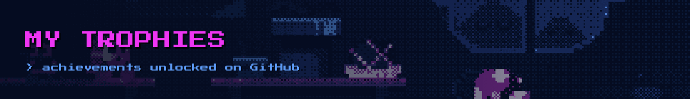</h3>

<picture><source media="(prefers-color-scheme: light)" srcset="https://github-trophies.vercel.app/?username=kunalshah017&theme=flat&column=7&no-bg=true&margin-w=15&margin-h=10"></picture>

<h3>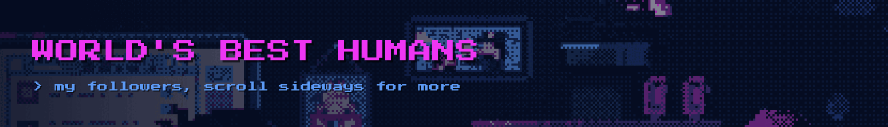</h3>

<!-- FOLLOWER-LIST:START -->
<table>
  <tr>

<td align="center">
     
      
     <a href="https://github.com/idimetrix">idimetrix</a>
  </td>
    
<td align="center">
     
      
     <a href="https://github.com/ARJUN-R34">ARJUN-R34</a>
  </td>
    
<td align="center">
     
      
     <a href="https://github.com/bludnic">bludnic</a>
  </td>
    
<td align="center">
     
      
     <a href="https://github.com/vishalxrana">vishalxrana</a>
  </td>
    
<td align="center">
     
      
     <a href="https://github.com/standardgalactic">standardgalactic</a>
  </td>
    
<td align="center">
     
      
     <a href="https://github.com/MXmaster2s">MXmaster2s</a>
  </td>
    
<td align="center">
     
      
     <a href="https://github.com/Piyushchy">Piyushchy</a>
  </td>
    
<td align="center">
     
      
     <a href="https://github.com/theavitw">theavitw</a>
  </td>
    
<td align="center">
     
      
     <a href="https://github.com/manuqlly">manuqlly</a>
  </td>
    
<td align="center">
     
      
     <a href="https://github.com/MannJadwani">MannJadwani</a>
  </td>
    
<td align="center">
     
      
     <a href="https://github.com/NisargPipaliya">NisargPipaliya</a>
  </td>
    
<td align="center">
     
      
     <a href="https://github.com/Shanmukhapriya2003">Shanmukhapriya2003</a>
  </td>
    
<td align="center">
     
      
     <a href="https://github.com/MoinMN">MoinMN</a>
  </td>
    
<td align="center">
     
      
     <a href="https://github.com/FURIOUSCHAMP007">FURIOUSCHAMP007</a>
  </td>
    
<td align="center">
     
      
     <a href="https://github.com/SetuBhatt1">SetuBhatt1</a>
  </td>
    
<td align="center">
     
      
     <a href="https://github.com/snowflakke">snowflakke</a>
  </td>
    
<td align="center">
     
      
     <a href="https://github.com/web3sandyyy">web3sandyyy</a>
  </td>
    
<td align="center">
     
      
     <a href="https://github.com/xhakti">xhakti</a>
  </td>
    
<td align="center">
     
      
     <a href="https://github.com/Aashu-shinde-012">Aashu-shinde-012</a>
  </td>
      </tr>
  <tr>

<td align="center">
     
      
     <a href="https://github.com/rahuloraj">rahuloraj</a>
  </td>
    
<td align="center">
     
      
     <a href="https://github.com/omtathe">omtathe</a>
  </td>
    
<td align="center">
     
      
     <a href="https://github.com/Tanvimisar">Tanvimisar</a>
  </td>
    
<td align="center">
     
      
     <a href="https://github.com/shiffsyedd">shiffsyedd</a>
  </td>
    
<td align="center">
     
      
     <a href="https://github.com/ananya-dhiman">ananya-dhiman</a>
  </td>
    
<td align="center">
     
      
     <a href="https://github.com/SW42-kj">SW42-kj</a>
  </td>
    
<td align="center">
     
      
     <a href="https://github.com/LyfSeeker">LyfSeeker</a>
  </td>
    
<td align="center">
     
      
     <a href="https://github.com/aashutosh1234567">aashutosh1234567</a>
  </td>
    
<td align="center">
     
      
     <a href="https://github.com/tarunj292">tarunj292</a>
  </td>
    
<td align="center">
     
      
     <a href="https://github.com/Gauri693">Gauri693</a>
  </td>
    
<td align="center">
     
      
     <a href="https://github.com/bishnoisujal99">bishnoisujal99</a>
  </td>
    
<td align="center">
     
      
     <a href="https://github.com/KGandhi90">KGandhi90</a>
  </td>
    
<td align="center">
     
      
     <a href="https://github.com/LUCIFER-19-BIT">LUCIFER-19-BIT</a>
  </td>
    
<td align="center">
     
      
     <a href="https://github.com/manav-os">manav-os</a>
  </td>
    
<td align="center">
     
      
     <a href="https://github.com/pradnya1105">pradnya1105</a>
  </td>
    
<td align="center">
     
      
     <a href="https://github.com/nayanchellani">nayanchellani</a>
  </td>
    
<td align="center">
     
      
     <a href="https://github.com/kunal-astryx">kunal-astryx</a>
  </td>
    
<td align="center">
     
      
     <a href="https://github.com/tyraakj">tyraakj</a>
  </td>
    
<td align="center">
     
      
     <a href="https://github.com/vyqno">vyqno</a>
  </td>
      </tr>
</table>
<!-- FOLLOWER-LIST:END -->

<h3>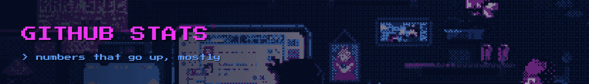</h3>

<picture><source media="(prefers-color-scheme: light)" srcset="https://raw.githubusercontent.com/kunalshah017/kunalshah017/output/top-langs-light.svg"></picture>
<picture><source media="(prefers-color-scheme: light)" srcset="https://raw.githubusercontent.com/kunalshah017/kunalshah017/output/stats-light.svg"></picture>

<picture><source media="(prefers-color-scheme: light)" srcset="https://github-readme-streak-stats.herokuapp.com/?user=kunalshah017&border_radius=10&background=FCFAFF&border=E7DDF3&ring=B620C9&fire=B620C9&currStreakNum=1F1A2E&currStreakLabel=B620C9&sideNums=1B51A1&sideLabels=1F1A2E&dates=6B6485&stroke=E7DDF3"></picture>

<h3>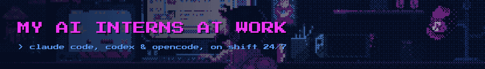</h3>

<picture><source media="(prefers-color-scheme: light)" srcset="https://raw.githubusercontent.com/kunalshah017/kunalshah017/main/src/images/ai-usage-light.svg"></picture>

<h3>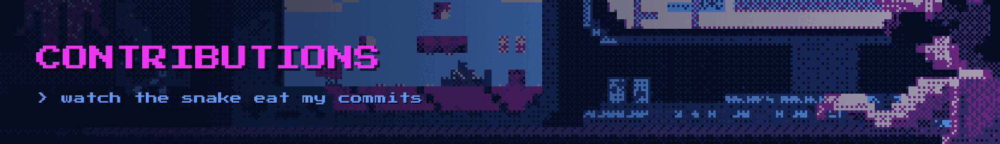</h3>

<picture>
  <source media="(prefers-color-scheme: dark)" srcset="https://raw.githubusercontent.com/kunalshah017/kunalshah017/refs/heads/output/github-contribution-grid-snake-dark.svg">
  <source media="(prefers-color-scheme: light)" srcset="https://raw.githubusercontent.com/kunalshah017/kunalshah017/refs/heads/output/github-contribution-grid-snake.svg">
  
</picture>

 

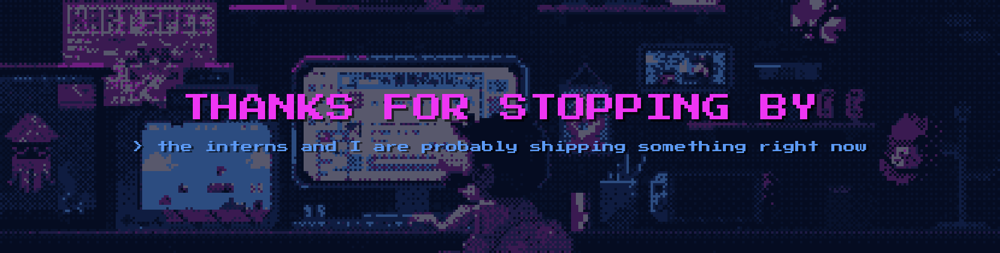

